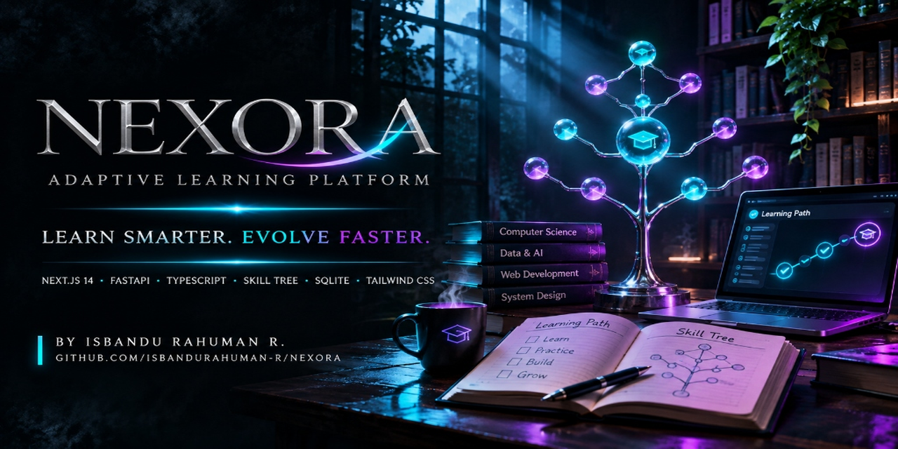
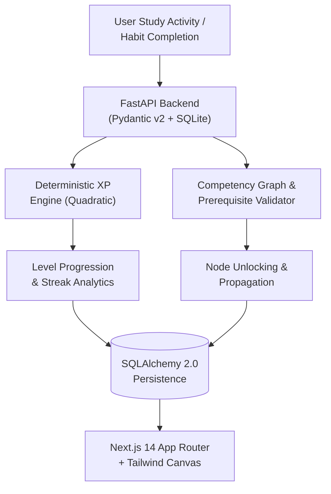

<p align="center">
  
</p>

# ◈ NEXORA — Skill Tree & Personal Growth Engine

[](https://github.com/ISBANDURAHUMAN-R/NEXORA/actions)

## ◆ About the Project
NEXORA is a web application that organizes learning activities, habits, and self-development into an interactive RPG-style skill tree. Instead of simple task lists, it structures progression across interconnected competency nodes with prerequisite dependencies and deterministic XP leveling mechanics.



## ❖ Key Features
- Interactive visual skill tree canvas with pan, zoom, and dynamic status indicators.
- Deterministic XP and leveling engine with quadratic leveling curves and difficulty multipliers.
- Session logging module recording study duration, activity notes, and earned experience.
- Rule-based recommendation engine evaluating prerequisite readiness without external AI APIs.
- Analytics dashboard featuring XP growth trajectories and weekly learning distribution charts.

## ⬢ Technologies Used
- Python 3.10+
- FastAPI & Pydantic v2
- SQLAlchemy 2.0 & SQLite
- Next.js 14 (App Router)
- React 18 & TypeScript
- Tailwind CSS
- Recharts & Lucide React

## § Requirements
- Python 3.10 or higher
- Node.js 18 or higher

## ▲ Installation & Execution
```bash
# 1. Start Backend
cd backend
python -m venv .venv
source .venv/bin/activate  # On Windows: .venv\Scripts\activate
pip install -r requirements.txt
uvicorn main:app --reload --port 8000

# 2. Start Frontend
cd ../frontend
npm install
npm run dev
```

## ※ Developer
Developer: ISBANDU RAHUMAN R  
GitHub: https://github.com/ISBANDURAHUMAN-R
